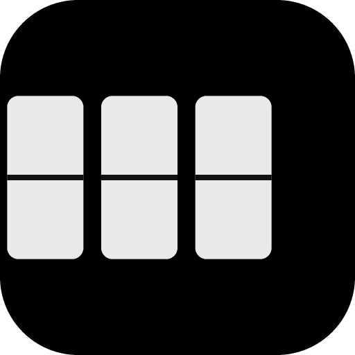
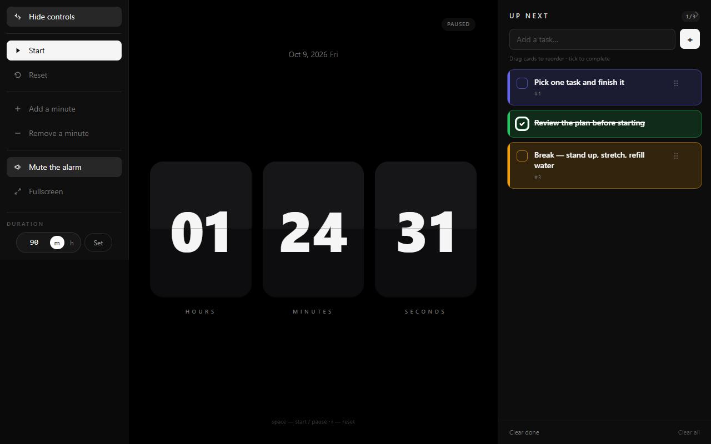

<div align="center">
  
  <h1>Timer</h1>
  <p>A split-flap countdown timer with a student task list — subtasks, focus tracking, and a page of its own. Installable, works offline.</p>
</div>

---



Two pages: the **timer** — a three-column layout with a collapsible control rail
on the left, the black split-flap clock in the middle, and a quick task list on
the right — and the **tasks page** at `#/tasks`, where tasks get subtask
checklists and focus tracking. Fold both side panels away on the timer and the
clock takes the whole screen.
No accounts, no server, no tracking — everything lives in `localStorage`.

## Features

**Clock**
- Split-flap panels showing **hours, minutes and seconds**, with a real folding leaf on every change
- Any duration you like: type `8h`, `90m`, `1h30m`, `2 hours`, `0.5h` or just `45`
- Drifts by nothing — the countdown is derived from a wall-clock deadline, not a tick count
- Rings three tones and stops at `00:00`; press **Run again** to repeat the same duration
- Nudge the countdown by a minute without disturbing the full duration

**Control rail** — collapses to a 56px column of icons, opens to 232px with labels
- Start / pause, reset, ±1 minute
- Mute the alarm (remembered across reloads)
- Fullscreen
- The duration field, so the clock itself needs no controls at all

**Tasks**
- Every new card is given a **random colour**, and never the same one twice in a row
- **Drag to reorder** (the handle appears on hover)
- Tick a card to finish it — it fades out and strikes through
- Delete per card, plus *Clear done* and *Clear all*
- Collapses to a 44px rail so the clock can have the room

**Tasks page** (`#/tasks`) — the same list with room to breathe
- **Subtask checklists**: open a task, break it into steps, watch the progress bar fill
- **Focus tracking**: mark a task with the ◎ target, and every session the clock finishes
  is logged onto it — session count and focused minutes, on the card and on the clock
- A **live timer pill** in the header: pause/play and the countdown while you plan;
  click it to jump back to the clock
- Completed tasks sink into their own group at the bottom
- Reachable from the control rail, the side panel, or `t`; `Escape` comes back

**Everywhere else**
- **PWA** — installable to the home screen, works fully offline via a service worker
- **Phone landscape** gets the same three-column layout; fold both rails and the panels grow ~50%
- Works in portrait too — it stacks
- `space` and `r` shortcuts, and the dark scheme is fixed rather than following the OS

## Getting started

```bash
npm install
npm run dev          # http://localhost:5173
```

| Script | What it does |
| --- | --- |
| `npm run dev` | Dev server with hot reload |
| `npm run build` | Type-check, then build to `dist/` |
| `npm run preview` | Serve the production build (needed to test the service worker) |
| `npm run lint` | Lint with oxlint |
| `npm run icons` | Regenerate the PWA icons into `public/` |

> **The service worker is off in dev on purpose** — a caching worker fights with hot reload.
> Run `npm run build && npm run preview` to test install and offline behaviour.

### Keyboard

| Key | Action |
| --- | --- |
| `space` | Start / pause |
| `r` | Reset to the full duration |
| `t` | Open the tasks page |
| `Escape` | Back to the timer (tasks page) |
| `Enter` | Apply the duration you typed |

## Tech

React 18 · Vite 8 · TypeScript · Tailwind CSS v3 · [`cite-ui`](https://www.npmjs.com/package/cite-ui) · `vite-plugin-pwa`

`cite-ui` provides the toast notifications and the `localStorage` hook. Everything else —
the flip animation, drag-and-drop, duration parsing — is hand-rolled and dependency-free.

### Layout

```
src/
  App.tsx                    routing, persistence, focus logging, rail states
  pages/
    TasksPage.tsx            #/tasks — checklist + focus tracking workspace
  components/
    Clock.tsx                the countdown readout and status (display only)
    FlipPanel.tsx            one split-flap panel (static halves + folding leaf)
    ControlRail.tsx          collapsible left rail: run/reset/±1m/sound/fullscreen
    DurationInput.tsx        duration parsing + the m/h toggle
    TaskList.tsx             add, reorder, clear — the timer's quick view
    TaskCard.tsx             one draggable card in the quick view
    TaskRow.tsx              one expandable row on the tasks page
    TimerPill.tsx            live countdown readout for the tasks page header
    CollapseRail.tsx         the narrow rail when the task panel is collapsed
  lib/
    duration.ts              parse "8h" / "90m" / "1h30m" → minutes, clock formats
    tasks.ts                 task & subtask types, colours, list operations
    audio.ts                 the end-of-session chime
  hooks/
    useLocalStorage.ts       typed wrapper around cite-ui's hook
    useFullscreen.ts         fullscreen state + toggle
    useCountdown.ts          the wall-clock ticker + completion (runs across pages)
    useHashRoute.ts          #/timer ↔ #/tasks, no dependency
scripts/
  gen-icons.mjs              PNG encoder + the icon artwork
```

## Icons

`npm run icons` writes `icon-192.png`, `icon-512.png`, a maskable variant and the Apple touch
icon. The script encodes the PNGs itself using Node's built-in `zlib`, so regenerating the
artwork needs no image tooling.

## Deploying

The build output is a static site — host `dist/` anywhere. A PWA needs **HTTPS** to be
installable (localhost excepted). Nothing is server-side.